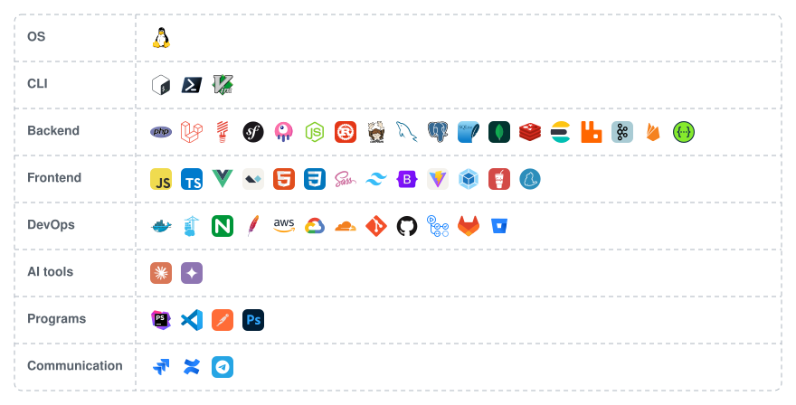

<!-- https://media.giphy.com/media/SWoSkN6DxTszqIKEqv/giphy.gif -->
<!--  -->

 * How to reach me: [contact@siberfx.com](mailto:contact@siberfx.com)
 * My website: [https://siberfx.com/](https://siberfx.com/)
 * [ @siberfx](https://instagram.com/siberfx)
 * [ @siberfx](https://www.linkedin.com/in/siberfx/)
 * [ @siberfx](https://x.com/siberfx)
 * [ @siberfx](https://t.me/siberfx)

  
  

 
 
 
 
 

  

<picture>
  <source media="(prefers-color-scheme: dark)" srcset="https://raw.githubusercontent.com/siberfx/siberfx/main/image/tech-stack-dark.svg" />
  <source media="(prefers-color-scheme: light)" srcset="https://raw.githubusercontent.com/siberfx/siberfx/main/image/tech-stack-light.svg" />
  
</picture>

 
 

<picture>
  <source media="(prefers-color-scheme: dark)" srcset="https://raw.githubusercontent.com/siberfx/siberfx/output/bomberman-contribution-graph-dark.svg" />
  <source media="(prefers-color-scheme: light)" srcset="https://raw.githubusercontent.com/siberfx/siberfx/output/bomberman-contribution-graph.svg" />
  
</picture>

 
 

**Latest Articles:**

<ul>
<!-- BLOG-POST-LIST:START --><li><a href="https://siberfx.com/article/react/filtering-gigantic-lists-in-react-a-custom-hook-with-usesyncexternalstore-and-usedeferredvalue">Filtering Gigantic Lists in React: A Custom Hook with useSyncExternalStore and useDeferredValue</a> — Nov 9, 2026</li>
<li><a href="https://siberfx.com/article/linux/enforcing-peruser-temp-directory-quotas-with-systemdtmpfiles">Enforcing Per‑User Temp Directory Quotas with systemd‑tmpfiles</a> — Nov 7, 2026</li>
<li><a href="https://siberfx.com/article/security/php-87-array-destructuring-cve20269999-and-the-path-to-arbitrary-code-execution">PHP 8.7 Array Destructuring: CVE‑2026‑9999 and the Path to Arbitrary Code Execution</a> — Nov 7, 2026</li>
<li><a href="https://siberfx.com/article/laravel/injecting-dynamic-rate-limits-into-laravel-queue-workers-via-the-service-container">Injecting Dynamic Rate Limits into Laravel Queue Workers via the Service Container</a> — Nov 7, 2026</li>
<li><a href="https://siberfx.com/article/php/typed-properties-with-union-types-in-php-85-enhancing-runtime-safety-2">Typed Properties with Union Types in PHP 8.5: Enhancing Runtime Safety</a> — Nov 7, 2026</li>
<!-- BLOG-POST-LIST:END -->
</ul>

➡️ [More articles](https://siberfx.com/)

